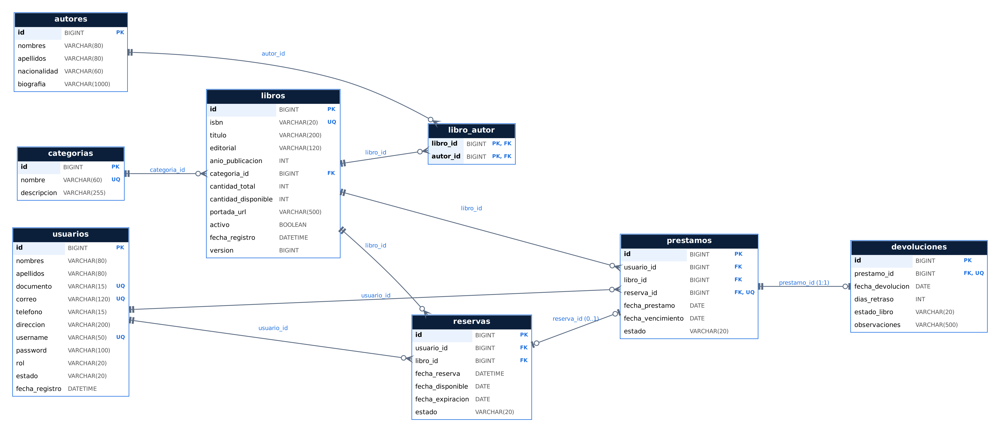

# 📚 Sistema de Gestión de Biblioteca

Sistema web full stack para administrar una biblioteca: catálogo de libros, autores y categorías, préstamos, devoluciones, reservas y usuarios, con control de acceso por roles.

> Proyecto académico en equipo – Universidad Tecnológica del Perú (UTP), Huancayo.
> Participación: **Sebastian Sabino Meza Morales**.


## Características destacadas

- **API REST** en Spring Boot con arquitectura en capas (controller · service · repository · dto)
- **Autenticación con JWT** y permisos por rol: **BIBLIOTECARIO** y **LECTOR**
- **Reglas de negocio reales**: límite de préstamos activos, reservas con cola de espera, vencimientos automáticos y baja lógica
- **Tareas programadas** que marcan préstamos vencidos y expiran reservas
- **Bloqueo optimista** (`@Version`) para evitar stock negativo en préstamos simultáneos
- **Manejo de errores centralizado** con respuestas JSON uniformes
- **24 pruebas** con JUnit 5, Mockito y pruebas de integración sobre H2
- **Documentación** con Swagger y colección de Postman
- **Frontend en Angular 20**: dashboard con indicadores, catálogo, gestión de préstamos y reservas, registro de lectores en 2 pasos

## Modelo de base de datos



## Capturas

<!-- Arrastra aquí tus capturas de pantalla desde el editor de GitHub -->

## Estructura

```
sistema-biblioteca/
├── backend/     → API REST (Spring Boot 3.3 · Java 17+ · Maven)
├── frontend/    → Aplicación web (Angular 20 · SASS)
├── database/    → script SQL de la base "biblioteca" y consultas de ejemplo
└── docs/        → colección de Postman y diagrama de la base de datos
```

---

## 1. Requisitos

| Herramienta | Versión |
|---|---|
| JDK | 17 o superior (21 recomendado) |
| IntelliJ IDEA | Community o Ultimate (trae Maven incluido) |
| MySQL Server | 8.x (usuario y contraseña propios, ver sección 2) |
| Node.js | 20.19+ o 22.12+ (`node -v`) |
| VS Code | cualquier versión reciente |

---

## 2. Base de datos (MySQL)

No hace falta crear tablas: al arrancar, el backend **crea la base `biblioteca`** (si no existe) y **genera las tablas** con Hibernate.
Solo asegúrese de que MySQL esté encendido.

### 2.1 Credenciales (no se suben al repositorio)

El código **no contiene contraseñas**. `application.properties` solo tiene variables
(`${DB_USER}`, `${DB_PASSWORD}`, `${JWT_SECRET}`) que se leen de:

1. **Un archivo local** (recomendado): copie `backend/application-local.properties.example`,
   renómbrelo a `backend/application-local.properties` y escriba su contraseña:

   ```properties
   DB_USER=root
   DB_PASSWORD=su_contraseña_de_mysql
   ```

   Ese archivo está en `.gitignore`, así que nunca se publica.

2. **O variables de entorno**: en IntelliJ, *Run → Edit Configurations → Environment variables*:
   `DB_USER=root;DB_PASSWORD=su_contraseña`.

`JWT_SECRET` es opcional: si no se define, el servidor genera una clave aleatoria en cada arranque
(solo obliga a iniciar sesión de nuevo después de reiniciar el backend).

> Si va a entregar el proyecto comprimido (.zip), **no incluya** `application-local.properties`.

### 2.2 Script y diagrama

- `database/crear_base_de_datos.sql`: crea la base y las 8 tablas con sus claves (opcional, Hibernate también las crea).
- `database/consultas_evidencias.sql`: consultas para las capturas (tablas con registros, CRUD, SQL equivalente a JPQL y transacción con `ROLLBACK`).
- `docs/diagrama-base-de-datos.png`: diagrama físico (tablas, columnas, PK, FK y cardinalidades).

La primera vez se cargan **datos de ejemplo** (15 libros, 15 autores, 10 categorías, 7 usuarios, préstamos, devoluciones y una reserva).

---

## 3. Backend en IntelliJ IDEA

1. **File → Open…** y seleccione la carpeta `backend` (la que tiene `pom.xml`). Acepte *Trust Project*.
2. Espere a que IntelliJ descargue las dependencias de Maven (barra inferior). Si no empieza: clic derecho en `pom.xml` → **Maven → Reload project**.
3. **File → Project Structure → Project → SDK:** elija JDK 17 o 21.
4. Abra `src/main/java/com/biblioteca/BibliotecaApplication.java` y presione ▶ **Run**.
5. En la consola debe ver: `Started BibliotecaApplication` y `Tomcat started on port 8080`.

| Qué | Dónde |
|---|---|
| API | http://localhost:8080/api |
| Swagger (documentación interactiva) | http://localhost:8080/swagger-ui.html |

**Probar sin MySQL** (opcional): Run → Edit Configurations → *Active profiles*: `h2`. Usa una base en memoria.

**Pruebas:** clic derecho en `src/test/java` → **Run 'All Tests'** (JUnit 5 + Mockito + pruebas de integración con H2).

---

## 4. Frontend en Visual Studio Code

1. **File → Open Folder…** y seleccione la carpeta `frontend`.
2. Abra la terminal (**Ctrl + ñ** o *Terminal → New Terminal*) y ejecute:

```bash
npm install
npm start
```

3. Abra **http://localhost:4200**. El backend debe estar corriendo en el puerto 8080.

> Si PowerShell bloquea `npm` ("la ejecución de scripts está deshabilitada"), ejecute una vez:
> `Set-ExecutionPolicy -Scope CurrentUser RemoteSigned` y vuelva a intentar.

---

## 5. Usuarios de prueba

| Rol | Usuario | Contraseña | Qué puede hacer |
|---|---|---|---|
| BIBLIOTECARIO | `admin` | `Admin123` | Todo: dashboard, libros, autores, categorías, usuarios, préstamos, devoluciones y reservas |
| LECTOR | `jperez` | `Lector123` | Catálogo, sus préstamos, sus reservas (crear/cancelar) y su cuenta |

También se puede ingresar con el correo (`admin@biblioteca.pe`). En la pantalla de login hay botones para rellenarlos.

**Nuevos lectores:** en el login, pestaña **Crear cuenta** (o http://localhost:4200/registro). El registro tiene 2 pasos (datos personales → cuenta), crea siempre un usuario con rol LECTOR y entra directo al catálogo. El bibliotecario también puede registrar lectores desde **Usuarios → Registrar usuario**.

---

## 6. Módulos y reglas de negocio

| Módulo | Requerimientos |
|---|---|
| Libros | RF-01 registrar · RF-02 consultar/actualizar/dar de baja · RF-03 disponibilidad en tiempo real |
| Autores | RF-04 CRUD · RF-05 asociar uno o varios autores a un libro |
| Usuarios | RF-06 CRUD y estados (activo/suspendido/inactivo) · RF-07 historial de préstamos |
| Préstamos | RF-08 registrar · RF-09 consultar activos y vencidos |
| Devoluciones | RF-10 registrar devolución · RF-18 historial |
| Reservas | RF-11 registrar · RF-12 actualización automática · RF-15 cancelar |
| Seguridad | RF-13 login con JWT · RF-14 permisos por rol · RF-19 autorregistro de lectores |
| Dashboard | RF-16 indicadores · RF-17 categorías |

**Reglas:**
- RN-01 Plazo por defecto: 14 días (máximo 60).
- RN-02 Máximo 3 préstamos activos por usuario.
- RN-03 No pueden pedir préstamos ni reservas los usuarios suspendidos o inactivos, ni los que tienen préstamos vencidos.
- RN-04 Solo se presta si hay ejemplares, o si el usuario tiene ese libro apartado por reserva.
- RN-05 Un usuario no puede tener dos veces el mismo libro.
- RN-06 Solo se reservan libros **sin** ejemplares disponibles, y una sola reserva activa por usuario y libro.
- RN-07 Al devolver un libro, si hay reservas en espera se aparta para la más antigua (estado DISPONIBLE, 3 días para retirar). Si no hay, vuelve al stock.
- RN-08 Una reserva no retirada en 3 días pasa a EXPIRADA y la unidad pasa a la siguiente reserva.
- RN-09 Los préstamos que pasan su fecha límite se marcan como VENCIDO (al iniciar el sistema, todos los días a las 00:05 y en cada consulta).
- Un libro devuelto **dañado** se retira del inventario.
- Libros y usuarios con historial no se borran: se dan de baja (baja lógica).

---

## 7. Endpoints principales

| Método | Ruta | Rol |
|---|---|---|
| POST | `/api/auth/login` | público |
| POST | `/api/auth/registro` (crea un LECTOR y devuelve el token) | público |
| GET | `/api/auth/me` | autenticado |
| GET | `/api/libros?q=&categoriaId=&autorId=&disponible=&page=&size=` | autenticado |
| GET | `/api/libros/{id}` · `/api/libros/{id}/disponibilidad` | autenticado |
| POST · PUT · DELETE | `/api/libros` · `/api/libros/{id}` | BIBLIOTECARIO |
| PUT | `/api/libros/{id}/autores` | BIBLIOTECARIO |
| GET · POST · PUT · DELETE | `/api/autores` · `/api/autores/{id}` | GET autenticado, resto BIBLIOTECARIO |
| GET · POST · PUT · DELETE | `/api/categorias` · `/api/categorias/{id}` | GET autenticado, resto BIBLIOTECARIO |
| GET · POST · PUT | `/api/usuarios` · `/api/usuarios/{id}` | BIBLIOTECARIO |
| PATCH | `/api/usuarios/{id}/estado` | BIBLIOTECARIO |
| GET | `/api/usuarios/{id}/resumen` · `/api/usuarios/{id}/prestamos` | el propio usuario o BIBLIOTECARIO |
| GET | `/api/prestamos?estado=&usuarioId=&q=` | autenticado (el lector solo ve los suyos) |
| POST | `/api/prestamos` | BIBLIOTECARIO |
| GET · POST | `/api/devoluciones` | GET autenticado, POST BIBLIOTECARIO |
| GET · POST | `/api/reservas` | autenticado (el lector reserva para sí mismo) |
| PATCH | `/api/reservas/{id}/cancelar` | dueño o BIBLIOTECARIO |
| GET | `/api/dashboard` | BIBLIOTECARIO |

Para probarlos con Postman: **Import** → `docs/Biblioteca-API.postman_collection.json` → ejecute *Login bibliotecario* (el token se guarda solo).

---

## 8. Arquitectura del backend

```
com.biblioteca
├── controller/   @RestController: reciben HTTP y devuelven JSON
├── service/      lógica de negocio y transacciones (@Transactional)
├── repository/   Spring Data JPA + consultas JPQL
├── model/        entidades JPA (Libro, Autor, Categoria, Usuario, Prestamo, Devolucion, Reserva)
├── dto/          objetos de entrada/salida con validaciones (Bean Validation)
├── security/     JWT (JwtService, filtro, UserDetailsService)
├── exception/    errores con formato único (@RestControllerAdvice)
└── config/       seguridad, CORS, Swagger, datos de ejemplo y tareas programadas
```

## 9. Problemas frecuentes

| Problema | Solución |
|---|---|
| `Access denied for user 'root'` | Falta o es incorrecta la contraseña: revise `backend/application-local.properties` (sección 2.1). |
| `Communications link failure` | MySQL no está encendido (servicio MySQL80 en Windows). |
| `Port 8080 was already in use` | Cierre otra app en ese puerto o cambie `server.port`. |
| El frontend dice "No se pudo conectar con el servidor" | El backend no está corriendo en el puerto 8080. |
| Las portadas no cargan | Se muestran portadas generadas automáticamente (necesitan internet para las reales). |

---

## 10. Prueba transaccional

En Postman, carpeta *5. Préstamos y devoluciones*:

1. **Transacción: disponibilidad ANTES** → anote `cantidadDisponible`.
2. **Transacción: préstamo con plazo > 60 días** → responde **409**. El servicio ya había descontado
   el ejemplar cuando detectó el plazo inválido; como el método es `@Transactional`, la excepción
   **revierte todo**.
3. **Transacción: disponibilidad DESPUÉS** → `cantidadDisponible` es igual al paso 1.

La misma prueba se ejecuta de forma automática en `PersistenciaIntegrationTest.prestamoFallidoNoAlteraElStock`.

---

## Autor

**Sebastian Sabino Meza Morales**
Estudiante de Ingeniería de Sistemas e Informática – UTP
[LinkedIn](https://www.linkedin.com/in/sebastian-meza-morales-3916aa280) · [GitHub](https://github.com/Sebas123ZS)
